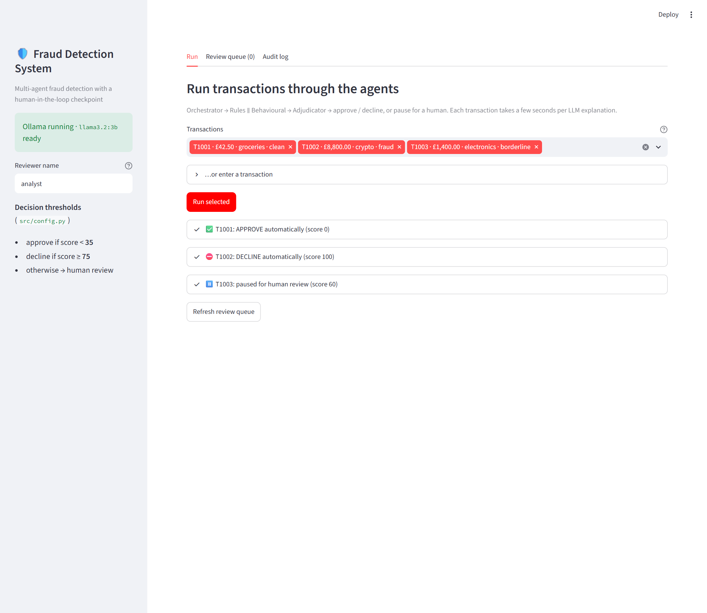
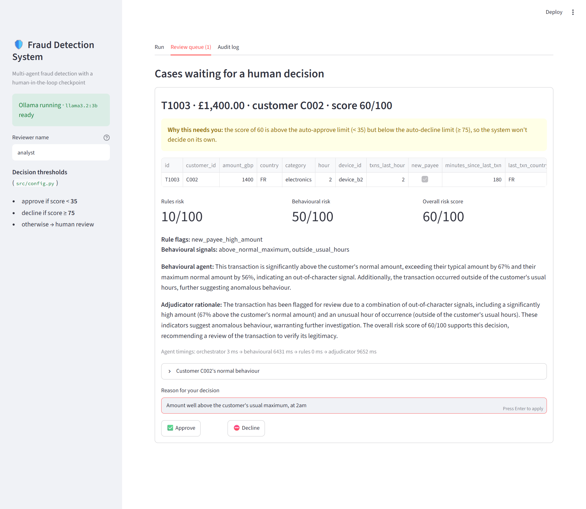
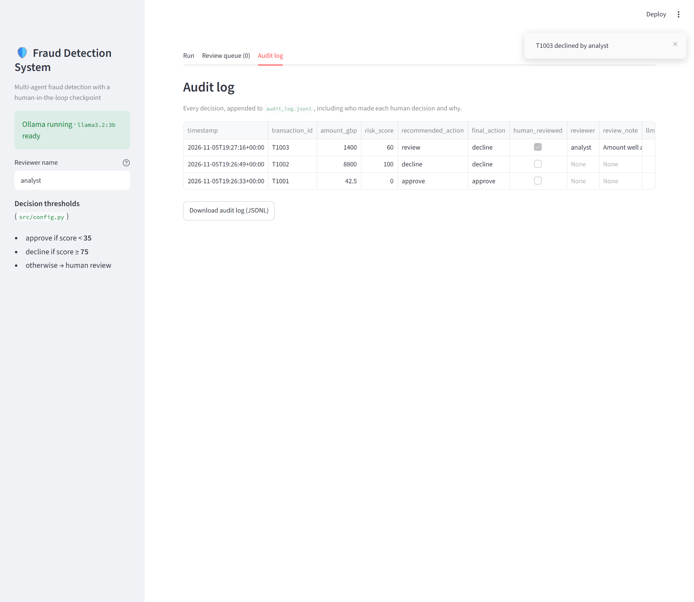

# Fraud Detection System

A multi-agent fraud detection project built with LangGraph for the Agentic AI
Bootcamp (DAIM Lab, University of Hull).

Each transaction is checked by two agents, a rules agent and a behavioural
agent. An adjudicator combines their results into a risk score from 0 to 100.
Clear cases are approved or declined automatically, and borderline cases are
paused until a person reviews them in the dashboard.

## Setup

Follow [docs/setup-guide.md](docs/setup-guide.md) to install Python, create a
virtual environment and install Ollama. Then:

```bash
ollama pull llama3.2:3b
pip install -r requirements.txt
python test.py        # should print "setup works"
```

## Running it

```bash
streamlit run app.py              # dashboard
python -m src.main                # command-line demo (T1001-T1003)
python -m src.main --limit 20     # first 20 transactions
pytest                            # tests, no Ollama needed
```

## How it works

```
orchestrator ─┬─ rules ───────┬─ adjudicator ─┬─ approve / decline ─┬─ audit log
              └─ behavioural ─┘               └─ human review ──────┘
```

| Step | What it does |
|---|---|
| Orchestrator | Validates the transaction and looks up the customer's history |
| Rules | Fixed checks: large amount, too many transactions in an hour, impossible travel, blocklisted device, large payment to a new payee |
| Behavioural | Compares the transaction with the customer's usual amount, hours, categories and country |
| Adjudicator | Adds the two risk scores together and picks an action |
| Human review | Pauses the run until someone approves or declines |
| Audit log | Records every decision, including who made it and why |

Rules and behavioural run in parallel. A score below 35 is approved, 75 or
above is declined, and anything in between goes to human review. The
thresholds and weights are in `src/config.py`.

The scores are calculated in Python. The LLM (`llama3.2:3b`, running locally
through Ollama) only writes the explanations shown to the reviewer. We tried
letting the model score transactions, but it got simple comparisons wrong, for
example treating £1,400 as within a £900 limit. If Ollama isn't running, a
plain template explanation is used and the decision doesn't change.

## Dashboard

- **Run**: run transactions from the dataset, or enter your own, and see what
  each agent found.
- **Review queue**: cases waiting for a decision, with the full reasoning.
  Approve or decline with a reason.
- **Audit log**: every decision made so far.

Paused cases are saved in `results/checkpoints.sqlite`, so they stay in the
queue after a restart.

Demo: run T1001-T1003. T1001 is approved, T1002 is declined, and T1003 goes to
the review queue.

## Data

`data/customers.csv` has 12 customer profiles and `data/transactions.csv` has
120 transactions. Both are synthetic, because public datasets such as PaySim
don't include fields like country, device or merchant category. The
`scenario` and `is_fraud` columns describe how each row was made. They're
removed before the agents see the data.

## Project structure

```
app.py                  Streamlit dashboard
test.py                 checks the LLM is reachable
data/                   customers and transactions
docs/setup-guide.md     machine setup
src/
  agents/               orchestrator, rules, behavioural, adjudicator
  graph.py              LangGraph workflow and human review step
  config.py             thresholds and weights
  models.py             transaction validation
  llm.py                Ollama model and fallback explanations
  tools.py              customer profile lookup and scoring tools
  audit.py              audit log
  sample_data.py        loads the CSV files
  state.py              shared state passed between agents
  observability.py      logging and timings
  main.py               command-line demo
tests/                  pytest tests
screenshots/            dashboard screenshots
```

## Screenshots

Running the three demo transactions: T1001 is approved, T1002 is declined and
T1003 is sent for review.



T1003 in the review queue, with each agent's findings and explanation.



The audit log after T1003 was declined by the reviewer.


