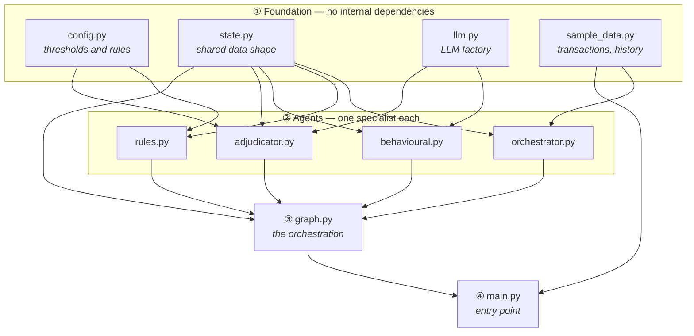
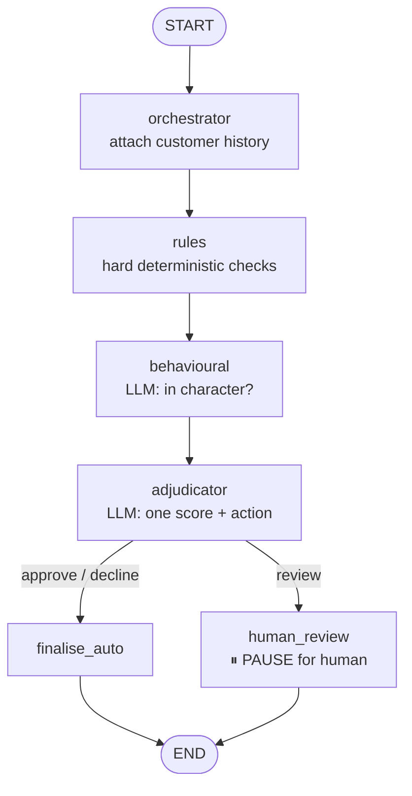
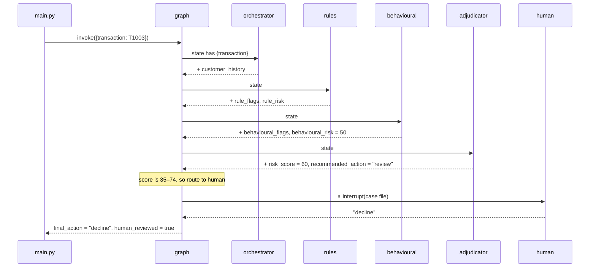

# SentinelAI — Code Walkthrough

*A guided tour of the codebase, in the order it makes sense to understand it.*

This document explains **what each file does, why it exists, and how they
connect**. It's ordered **foundation first** — the files with no dependencies,
then the ones built on top of them, ending with the entry point. If you read it
top to bottom, every file only uses things you've already met.

> The diagrams below use **Mermaid**, which GitHub renders automatically. If
> you're reading this in a plain text editor, the diagrams will show as code —
> view it on GitHub, or in any Markdown previewer with Mermaid support.

---

## 1. The two mental models

Before the files, hold two pictures in your head. Everything else hangs off
these.

### A. How the files depend on each other (the "structure" view)

This is the ER-diagram equivalent for the code. An arrow **A → B** means
*"A is used by B"*. Read it bottom-up: the foundation layer feeds the agents,
the agents feed the graph, the graph feeds the entry point.



### B. How a transaction flows at runtime (the "behaviour" view)

This is what actually happens when you run it. The graph (`graph.py`) walks a
transaction through the agents in order, then **branches**: clean/obvious cases
finish automatically, borderline cases pause for a human.



The key idea: **the structure view and the behaviour view are different.**
`graph.py` imports the agents (structure), but at runtime it *calls them in an
order the imports don't show* (behaviour). Keep them separate in your head.

---

## 2. The thing that connects everything: shared state

Every agent is wired together by **one object** that travels through the graph —
defined in `state.py`. Each agent reads what earlier agents wrote, adds its own
findings, and passes it on. Nothing is passed between agents by hand; they only
ever touch this shared state.

Think of it as a case file that each specialist adds a page to:

| Field | Written by | Meaning |
|---|---|---|
| `transaction` | *(input)* | The event being judged |
| `customer_history` | orchestrator | This customer's normal behaviour |
| `rule_flags`, `rule_risk` | rules | Which hard rules tripped, and how much risk |
| `behavioural_anomaly`, `behavioural_risk`, `behavioural_reasoning` | behavioural | Is it out of character, and why |
| `risk_score`, `rationale`, `recommended_action` | adjudicator | Final score, justification, and approve/decline/review |
| `final_action`, `human_reviewed` | human_review *or* finalise_auto | What actually happened, and whether a human was involved |

Once you understand this table, you understand how the agents "talk" to each
other: **they don't — they all read and write this one object.**

---

## 3. File by file, in build order

### ① Foundation layer

---

#### `config.py` — the dials

**What:** Plain constants. No logic, no imports.

**Why first:** It depends on nothing, and almost everything depends on it. Every
threshold the system uses lives here, so the decision boundaries can be changed
in one place without reading any agent code. This is the same "thresholds in one
place" discipline a good layered data model uses.

```python
APPROVE_BELOW = 35            # score below this -> auto-approve
DECLINE_AT_OR_ABOVE = 75      # score at/above this -> auto-decline
HIGH_AMOUNT_GBP = 5000        # a rule parameter
BLOCKLISTED_DEVICES = {...}   # known-bad devices
```

**Connects to:** `rules.py` (rule parameters) and `adjudicator.py` (the
score → action thresholds).

---

#### `state.py` — the case-file shape

**What:** A single `TypedDict` describing every field the shared state can hold
(the table in section 2).

**Why here:** Every agent and the graph refer to this shape. `total=False` means
agents fill the fields in gradually — the input only has to provide
`transaction`, and each agent adds its own keys as the case moves along.

**Connects to:** every agent and `graph.py`. It's the common vocabulary they all
speak.

---

#### `llm.py` — the one place the LLM is built

**What:** A single function, `get_llm()`, that returns the chat model.

**Why it's isolated:** Every LLM-using agent calls this one function, so
switching provider (Ollama → Gemini → OpenAI) is a **one-file change**. The
provider package is imported *inside* the function (lazy import), so nothing
loads until an agent actually needs a model — and the file can be imported even
if the provider isn't installed.

```python
@lru_cache(maxsize=1)          # build the model once, reuse it
def get_llm():
    from langchain_ollama import ChatOllama
    return ChatOllama(model="llama3.2:3b", temperature=0)
```

The model runs locally through Ollama, so there's no API key and no rate limit.

`temperature=0` keeps judgements stable run-to-run — important for a live demo.

**Connects to:** `behavioural.py` and `adjudicator.py` (the two LLM agents).

---

#### `sample_data.py` — the demo data

**What:** Loads `data/customers.csv` into `CUSTOMER_HISTORY` (what "normal"
looks like per customer) and `data/transactions.csv` into `SAMPLE_TRANSACTIONS`
(120 synthetic transactions, built by `scripts/generate_data.py`). The
`scenario` / `is_fraud` label columns are split off into `LABELS`, so no agent or
LLM prompt can see the answer. The first three rows are the hand-picked demo,
each landing in a different bucket:

- `T1001` — clean → should **approve**
- `T1002` — huge amount, blocklisted device, impossible travel → should **decline**
- `T1003` — £1,400 at 2am (above the customer's usual max, outside their usual
  hours) + new payee, but known device and home country → should **review**

**Why it's its own file:** Swapping in a real dataset (PaySim, the credit-card
fraud CSV) means replacing only this file — nothing downstream cares where the
transactions came from, as long as the fields match.

**Connects to:** `orchestrator.py` (reads the history) and `main.py` (iterates
the transactions).

---

### ② Agent layer — one specialist per file

Each agent is just **a function that takes the state and returns a dict of new
fields**. That dict gets merged into the shared state. That's the whole contract.

---

#### `orchestrator.py` — the setup step

**What:** The entry node. Looks up the transaction's customer in
`CUSTOMER_HISTORY` and attaches it to the state.

**Why it exists:** The downstream behavioural agent needs to compare the
transaction against the customer's norms, so *something* has to fetch those
norms first. In a LangGraph system the routing is the graph itself, so this node
does the orchestrator's *data-gathering* job rather than any dispatching.

```python
def orchestrator_node(state):
    history = CUSTOMER_HISTORY.get(state["transaction"]["customer_id"], {})
    return {"customer_history": history}      # <- merged into state
```

---

#### `rules.py` — fast, deterministic, no LLM

**What:** Applies hard rules — amount over threshold, too many transactions per
hour, impossible travel, blocklisted device, new payee + high amount. Each
triggered rule appends a flag and adds a fixed amount to this agent's risk
contribution.

**Why no LLM:** Hard rules should be **fast and auditable**. A blocklist hit is a
blocklist hit — it shouldn't depend on a model's interpretation. Keeping this
deterministic is a feature, not a shortcut.

```python
if txn["device_id"] in config.BLOCKLISTED_DEVICES:
    flags.append("blocklisted_device")
    risk += 40
return {"rule_flags": flags, "rule_risk": min(risk, 100)}
```

---

#### `behavioural.py` — Python checks, LLM explains

**What:** Answers one question: *is this transaction out of character for this
specific customer?* Python compares the transaction against the customer's
history and produces a list of signals — `above_normal_maximum`,
`outside_usual_hours`, `unusual_category`, `away_from_home`. Each signal adds a
weight from `config.BEHAVIOURAL_WEIGHTS` to the behavioural risk (0–100). The LLM
then writes a short explanation of those findings for the human reviewer.

```python
signals = _signals(txn, history)          # e.g. ["above_normal_maximum", "outside_usual_hours"]
risk = min(sum(config.BEHAVIOURAL_WEIGHTS[s] for s in signals), 100)
reasoning = get_llm().invoke(PROMPT.format(...)).content
```

**Why the LLM doesn't score:** The first version asked the LLM to judge and
score. The local `llama3.2:3b` model got the comparisons wrong — it called
£1,400 "within" a £900 maximum and 2am "within" 08:00–23:00 — so the borderline
case never reached human review. Comparisons are cheap and exact in Python; the
LLM does what it's good at, turning facts into readable prose. It deliberately
**ignores** hard rules (blocklists, velocity); that's the rules agent's
territory.

---

#### `adjudicator.py` — the decision rule, plus the rationale

**What:** Three steps.
1. Python adds the rules risk and the behavioural risk into **one** overall risk
   score (capped at 100).
2. A plain Python function maps that score to an action using the `config.py`
   thresholds.
3. The LLM reads every finding and writes a rationale for the human reviewer,
   explaining the decision it has been given.

```python
score = min(state["rule_risk"] + state["behavioural_risk"], 100)

def _action_from_score(score):
    if score < config.APPROVE_BELOW:       return "approve"
    if score >= config.DECLINE_AT_OR_ABOVE: return "decline"
    return "review"
```

**Why split it this way:** The **score and the routing are not left to the
LLM** — they're computed, so every decision is reproducible and defensible, and
you can explain exactly why a case was declined. The LLM's job is the
explanation a human analyst reads. The code scores; the thresholds route; the
model explains.

---

### ③ Orchestration

---

#### `graph.py` — the wiring, and the human checkpoint

**What:** Builds the LangGraph `StateGraph`: registers each agent as a **node**,
connects them with **edges**, and adds the **conditional branch** after the
adjudicator. This file *is* the orchestrator — the thing that decides which agent
runs when.

```python
builder.add_edge("behavioural", "adjudicator")
builder.add_conditional_edges("adjudicator", route_after_adjudication, {
    "human_review": "human_review",      # if recommended_action == "review"
    "finalise_auto": "finalise_auto",    # otherwise
})
```

**The human-in-the-loop, which is the headline feature:**

```python
def human_review_node(state):
    verdict = interrupt({                 # <- SUSPENDS the whole graph here
        "transaction": state["transaction"],
        "risk_score": state["risk_score"],
        "rationale": state["rationale"],
    })
    return {"final_action": verdict, "human_reviewed": True}
```

`interrupt()` genuinely **pauses** the graph and hands the case file back to the
caller. It only resumes once the caller sends the human's verdict back in. The
`MemorySaver` checkpointer at the bottom of the file is what makes this possible
— it saves the paused state so the run can be picked up exactly where it stopped.

---

### ④ Entry point

---

#### `main.py` — runs it and handles the pause

**What:** Loads settings from `.env`, builds the graph once, and pushes each sample
transaction through it. If a run comes back paused (an interrupt), it prints the
case file, asks a human on the console, and **resumes the graph with the
verdict**.

```python
result = graph.invoke({"transaction": txn}, config=cfg)

if "__interrupt__" in result:                 # the graph paused for a human
    payload  = result["__interrupt__"][0].value
    verdict  = ask_human(payload)             # input() on the console
    result   = graph.invoke(Command(resume=verdict), config=cfg)   # resume
```

That `invoke → (pause) → invoke(resume)` pattern is the entire human-in-the-loop
loop, seen from the outside.

---

## 4. Walking one transaction all the way through

Here's the borderline case `T1003` — the one that ends up in front of a human —
showing how the shared state grows at each step.



In words: the orchestrator attaches C002's history → rules finds only
`new_payee_high_amount` (risk 10) → the behavioural agent finds the amount is
above their maximum and the hour is outside their usual window (risk 50) → the
adjudicator adds these to 60, the middle band → because the score is neither low
nor high, the graph routes to `human_review` and **pauses** → the human declines
→ the graph resumes and records the outcome.

For `T1001` and `T1002` the same path runs, but the adjudicator's score lands
below 35 or at/above 75, so the branch goes to `finalise_auto` and **no human is
involved**.

---

## 5. Quick reference — where to change things

| I want to… | Edit |
|---|---|
| Move the approve/decline/review boundaries | `config.py` |
| Change or add a hard rule | `rules.py` (+ a parameter in `config.py`) |
| Change how "out of character" is judged | `_signals()` in `behavioural.py` (+ `BEHAVIOURAL_WEIGHTS` in `config.py`) |
| Change how findings are combined into a score | `adjudicator_node()` in `adjudicator.py` |
| Change the wording of explanations | the prompts in `behavioural.py` / `adjudicator.py` |
| Switch LLM provider | `llm.py` (one function) |
| Use real transaction data | `sample_data.py` |
| Add a whole new agent | new file in `agents/`, then one node + one edge in `graph.py` |
| Change what the human sees at review time | the `interrupt(...)` payload in `graph.py` |

---

## 6. The one sentence to remember

**The agents never talk to each other — they each read and write one shared
state object, and `graph.py` decides the order they run in and when to stop for a
human.** Everything else is detail.
